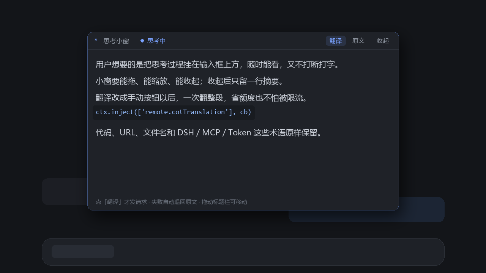

# dsh-cot-peek · 思考小窗

在 DSH Web 界面里悬浮一个置顶小窗，实时显示当前会话的思考过程（reasoning），
可收起，点一下按钮就翻成中文。



> 上面是示意图（按插件真实布局/配色渲染），不是截图。

**位置**：`shell.overlay` 顶层浮层，`position: fixed`，**始终待在对话列里面**：
它从输入框的数据座量出对话列的左右边界，宽度不会超出；**拖动时也过不去侧边栏**（0.5.5 起拖动被夹在对话列内），
**侧边栏一打开，对话列变窄，小窗自动跟着缩**，侧边栏收起后也会恢复您原本设的大小（用户尺寸单独记着，不被压缩掉）。
可拖动（按住标题栏）、可调大小（拖右下角），位置尺寸存在 localStorage
（最小 320×140，最大 960×800）。Windows 桌面版顶部有一条系统窗口拖拽区，
小窗最低只能停到它下面，不会压上去（压上去拖动会变成拖动整个 DSH，0.5.0 修复）。

**贴边与边缘抽屉**：把小窗拖到**对话列的左右边缘**松手，它会吸附到那一侧；
收起时只留一枚**边缘箭头**（左右自动换朝向）：

- 没有侧边栏（对话列贴着屏幕边）：和以前一样，窗体滑出视口，箭头停在屏幕边缘
- **有侧边栏**（0.5.5 起）：吸附位置是**对话列的边缘**，收起时窗体**原地隐藏**、只剩箭头，
  不会再滑到侧边栏上面去（箭头也在对话列里，不挡侧边栏）
- 箭头做**透明度呼吸**动画（只有透明度变化，大小不变）
- **悬停或点击箭头** → 窗体显示/滑入，完整显示文本框
- 鼠标离开 **1.5 秒**后自动收起（再进入会取消）
- 没有侧边栏时，滑入/滑出是 380ms 的缓动位移；`prefers-reduced-motion` 时箭头不呼吸
- 拖离边缘松手 → 解除吸附，回到对话列内自由漂浮

数据来自 `conversation.input.dock` 里的隐藏数据座（那里才有当前 Session 的 Chat 快照）。

## 它做什么

- 从 Chat 快照里直接读当前正在流式输出的 reasoning（不额外请求、不跑二次流）
- **自动翻译（默认开）**：每 2.5 秒检查一次有没有新思考，有就把**新增的已完结句子**送翻，
  整段不会重翻；标题栏「自动」按钮可随时关掉
- **手动翻译**：标题栏的「翻译」按钮，点一下立刻把当前整段翻完（没写完的尾巴也一起送）
- 英文思考 → 中文译文：代码块、行内代码、URL、文件名、术语先打成占位符，翻完原样还原
- 相同片段缓存，多句串行翻译（不冲垮免费翻译接口）
- 翻译失败自动退回原文，标题栏给出状态
- 手动模式下思考继续长时按钮会变成「再译」，提醒译文已经落后一截
- **对话结束 3 秒后自动滑出视口**，只留边缘箭头；中途又跑起来会取消
- 下一轮开始时，**自动收起的小窗会自己滑回来**；您**手动**收起的则保持收起
- **切换对话时边缘抽屉自动收回**，并且**不会自动翻译切过去的历史思考**
  （只把切换后新到达的文字算作新内容，避免白烧翻译额度）
- 可切换「译文 / 原文」
- 翻译服务不可用时，鼠标悬停标题栏的「翻译未启用」会显示具体卡在哪一步
  （服务未挂载 / 插件未启用 / 设置不可用 / 服务报错）

## 自定义翻译端点（本地模型 / 任意 OpenAI 兼容网关）

窗口标题栏的 **⚙** 可以配置一个 OpenAI 兼容端点，配好后**优先走它**，官方翻译包只作为回退。
常见地址：

| 跑什么 | base URL |
| --- | --- |
| LM Studio | `http://127.0.0.1:1234/v1` |
| Ollama（OpenAI 兼容） | `http://127.0.0.1:11434/v1` |
| 任意网关 | `https://your-gateway/v1` |

- **模型**可以留空（服务端只有一个模型时），留空就不传 `model` 字段
- **API Key** 可选，填了就带 `Authorization: Bearer …`
- 配置存在 **localStorage**，不进仓库；发送前同样会做代码 / URL / 术语占位保护
- 标题栏出现 **「本地」** 小标签表示当前走自定义端点
- 点「改用官方」清空配置，回到 Bing / Google / DeepSeek

> **CORS / 宿主代理（0.3.2+）**：本地和内网地址（`127.0.0.1`、`10.x`、`192.168.x`、`172.16-31.x`）
> 会先走 **DSH 宿时代理**（`/api/dsh-cot-peek/translate`），由宿主进程转发 —— **完全不受 CORS 限制**，
> 像 `dsh-our-free-model` 那种自带 `127.0.0.1:8326` 网关、但不发 CORS 头的插件也能直接接。
> 公网 `https` 地址仍由浏览器直连，需要对方允许跨域；宿主不存在时会自动回退到直连。

> **更新后要重启一次 DSH**：宿主半身（`/api/dsh-cot-peek/translate` 代理）只在 DSH 启动时加载，
> 只刷新页面只会更新客户端。重启前本地端点会退回浏览器直连，可能被 CORS 拦。
> 旧版 DSH 没有宿主路由时，插件会自动回退直连，不会因为 401 卡住。

## 设置页（0.3+）

插件会把自己注册进 DSH 的插件设置页：**设置 → 插件 → 思考小窗 · 翻译设置**。
在那里可以：

- 选翻译引擎：**官方**（Bing / Google / DeepSeek，走官方实验包）或 **自定义 OpenAI 兼容端点**
- 填端点地址、模型（可选）、API Key（可选）
- 点「保存」立即生效；点「改用官方」清空端点
- 点「**拉取模型列表**」：走宿主代理读端点的 `/v1/models`；拉取成功后会出现「**从拉取的列表里选模型 · N**」按钮，点开就是完整清单，选中即保存（0.5.3 起；0.5.4 不再用系统下拉——系统下拉在深色界面里是浅灰底浅灰字，看不清；0.5.6 换成**页面内列表框**，行和文字都写死浅色兜底，也不依赖自绘按钮）
- 点「**测试连接**」：用一句话试翻，直接告诉你通没通、返回了什么
- 「**平滑显示**」（0.4.4+）：思考文本按阅读速度（慢 40 / 正常 80 / 快 160 字每秒）逐字浮现，滚到底部才自动跟随；关掉就回到实时跳字。译文同样按这个速度显示（0.5.0 起），不会每隔 2.5 秒整段跳一次；落后太多时会自动加速追赶，不会越拖越慢（0.5.1）
- 滚轮随时可翻：一旦往上翻就**暂停自动跟随**，窗口底部出现「**↓ 回到底部**」按钮，点一下恢复跟随（0.4.5+）
- 「**累积整轮思考**」（0.4.6+，默认开）：思考→工具→思考的多步循环会把**同一轮所有步骤**连起来显示，不会在中途被下一段替换掉；关掉则只显示最新一段
- 平滑显示默认「慢」档 **40 字/秒**；嫌慢可在 ⚙ 面板切「正常」80 /「快」160（0.5.0 修好了三档标签，之前三档都显示「快」；0.5.4 起三档改成三个按钮，不用点开系统下拉）
- 小窗的 **⚙** 面板里也有同样的「拉取模型列表 / 测试连接」按钮；拉取成功会自动保存（0.4.2 起）
- **注意**：部分本地网关（如 Our Free Model）强制要求 `model`，不填会回 `model must be a string`；先点「拉取模型列表」选一个模型即可（0.4.1 起会自动选第一个）
- 页面上会提示 CORS 要求和隐私说明（发送前已对代码 / URL / 术语做占位保护）

窗口标题栏的 **⚙** 是同一个配置的快捷入口，两边读写同一份 localStorage。
点 ⚙ 时小窗会临时长高到能放下整个面板（360–460px），**再点一次或保存/改用官方关掉面板后，
窗口会恢复成打开前的大小**（0.5.2+）；如果在面板开着时自己拖过大小，则以您拖的为准。

## 自动 / 手动两种模式

- **自动（默认）**：每 2.5 秒看一眼思考有没有变长，变了就只翻**新增的完结句子**。
  整段不重翻、未写完的半句留原文，所以流式输出不会被翻译卡住。
  标题栏点「自动」可关掉，选择记在 localStorage。
- **手动**：关掉自动后，「翻译」按钮点一次翻整段（也就是把没写完的尾巴也送出去）。
  两者不冲突：自动开着时点「翻译」，会立刻把整段补齐，之后又回到增量模式。

> 为什么自动要限频：免费接口（Bing）会被限流，逐句实时翻译又慢又容易被拒；
> 现在 2.5 秒一收，既跟得上，也不会把请求打爆。

## 翻译管线（为什么快、为什么不会硬翻术语）

1. **省**
   - 增量：自动模式下只送新增的完结句子，同一句永远只翻一次
   - 手动触发：点「翻译」才整段翻（含未写完的尾巴）
   - 串行 + 合句：短句合并到 ≥28 字符再发，减少请求数
   - 缓存：同一句只翻一次（思考里重复很多）
2. **准**
   - 送整句、不送碎片；合句后语义完整
3. **不硬翻专业术语**
   - 发出前先用**占位符**把代码块、行内代码、URL、文件名、术语表里的词
     替换成 `⟦1⟧` 这类标记，翻译引擎看不到它们，翻完再原样还原
   - 术语表在 `client.js` 的 `KEEP_TERMS`，默认保留英文：
     DSH / MCP / LLM / API / SDK / JSON / Session / Token / Prompt / Context /
     Slot / Plugin / Bundle / Agent / Tool / Stream / Markdown …

   想加词：往 `KEEP_TERMS` 里加一条即可。

## 会话隔离（为什么不会串台）

窗口的数据座是 `conversation.input.dock` 里的一个隐藏 `<span>`，它往一个**单例 bridge** 写
`{ sessionId, text, running, bounds }`，浮层窗口只渲染 bridge 的当前值：

- **只有当前挂载会话的数据座在写**；切换会话时旧数据座先卸载并清空 bridge（`sessionId: null`），
  窗口随之隐藏，新会话再写入自己的快照
- 窗口按 `sessionId` 切换时重置翻译缓存并自动收起，所以**不会读到别的会话的 reasoning**
- 同一窗口里后台/未聚焦的会话不会写入；多开窗口各自是独立渲染进程，bridge 互不影响
- 已知边界：**多智能体（subagent）的思考不在主对话快照里**，窗口只显示主对话的 reasoning

## 装完就有翻译吗？

**默认没有。** 插件本体只负责显示思考 + 调用翻译入口，真正翻译需要二选一：

1. **官方翻译实验包**（推荐，免配置）：安装 `@deepseek-ai/dsh-experimental-cot-translation-bundle`，
   到「插件页 → 官方分组」启用「思考过程机器翻译」；默认走 Bing，免费
2. **自定义端点**（0.3+）：设置 → 插件 → 思考小窗 → 选「自定义 OpenAI 兼容端点」，
   填本地 LM Studio / Ollama / 任意网关地址

两者都没配时，窗口会显示「翻译未启用 · 装官方翻译包或配端点」，其余功能照常可用。

> 端点填**完整 URL**（以 `/chat/completions` 结尾）也能用，例如 `http://127.0.0.1:8326/v1/chat/completions`。

## 依赖

中文译文依赖官方实验包：

```
@deepseek-ai/dsh-experimental-cot-translation-bundle
```

它提供 Host 侧的 `translator` 服务和 Client 侧的 `ctx.remote.cotTranslation`。
不装也能用，只是小窗显示英文原文，标题栏标「翻译未启用」（悬停或点按钮能看到具体原因）。

本插件的 `package.json` 里 `dsh.client.inject` **必须**声明 `@deepseek-ai/dsh-api-remotes`
——那是提供 `remote` 服务的客户端包；不声明的话 `ctx.get('remote')` 永远是 `undefined`，
表现就是「翻译未启用」。另外客户端 `inject` 数组里要有 `remote`（与官方翻译插件一致），
读取嵌套命名空间用 `ctx.get('remote.cotTranslation')`：cordis 的 `ctx.get(name)` 是
**绕过 inject 要求**直接读服务仓的，这是最稳的一条路；`ctx.inject(['remote.cotTranslation'])`
作为第二条路兜底等待挂载。

翻译服务默认 **Bing**（免费、免登录），可在
「设置 → 插件 → 思考过程机器翻译」里换成 Google 或 DeepSeek（付费）。
> 实测：Google 的 `translate.googleapis.com` 在国内网络下连不通，Bing 的
> `edge.microsoft.com` 是可用的，建议保持默认。

## 安装

从 npm 安装（推荐）：

```
dsh plugin --profile desktop add dsh-cot-peek
```

或者在 DSH「设置 → 插件市场」里加入下面的索引源，在「发现」页一键装：

```
https://gh-proxy.com/https://raw.githubusercontent.com/wunainana/dsh-cot-peek/main/market.json
```

本地目录链接（开发时）：

```
dsh plugin --profile desktop add link:<本目录的绝对路径>
```

从 GitHub 装（SSH，适合 HTTPS 到 GitHub 不通的网络）：

```
dsh plugin --profile desktop add "git+ssh://git@github.com:wunainana/dsh-cot-peek.git"
```

安装后重启 DSH 生效。

## 发布

- **npm**：已发布 `dsh-cot-peek@0.3.0` → <https://www.npmjs.com/package/dsh-cot-peek>
- **插件市场索引**：仓库根目录的 `market.json`（格式 1，已通过 DSH 自带
  `@deepseek-ai/dsh-plugin-market-index` 校验）。把它加进
  「设置 → 插件市场 → 索引源」即可在「发现」页看到：

  ```
  https://gh-proxy.com/https://raw.githubusercontent.com/wunainana/dsh-cot-peek/main/market.json
  ```

  直连 GitHub 的网络也可以直接用 raw 地址：

  ```
  https://raw.githubusercontent.com/wunainana/dsh-cot-peek/main/market.json
  ```

- **发新版本**：改 `package.json` 的 version → `npm publish --access public` →
  更新 `market.json` 里该版本的 `version` 与 `publishTimestamp` → 提交推送。
  npm 账户开了 2FA，发布需要 `--otp=<6位码>` 或 Bypass 2FA 的 granular token。

## 文件

```
package.json       bundle 清单（dsh.bundle.patch + dsh.client）
cordis.patch.yml   把 cot-peek 这一行插进 profile
index.js           Host 半身：空实现（功能全在浏览器）
client.js          全部逻辑：取 reasoning、分句、术语保护、手动翻译、UI
locale/zh.json     插件管理页里显示的中文标题/描述
locale/en.json     英文标题/描述
icon.svg           原创图标
market.json        插件市场索引（format 1）
```

## 已知限制

- 「累积整轮思考」按节点的 `data.turn` 拼接同一轮的所有 step；个别 DSH 版本的节点没有该字段时，
  会退回「只显示最新一段」（累积上限 2 万字，超出保留尾部）
- 多智能体（subagent）的思考不在主对话快照里，窗口看不到子代理的 reasoning
- 手动翻译：翻完之后思考继续长，译文会落后，按钮变成「再译」提醒您
- 翻译走匿名接口，可能被限流或拒绝；失败时自动显示原文
- 改完 `client.js` 需要刷新页面（Client 插件重载）
